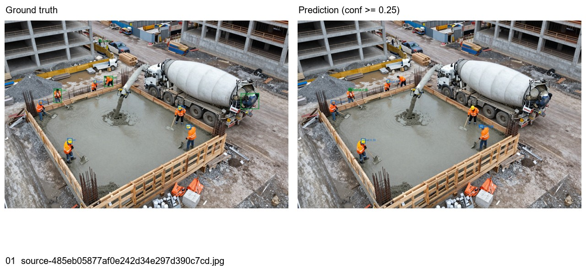
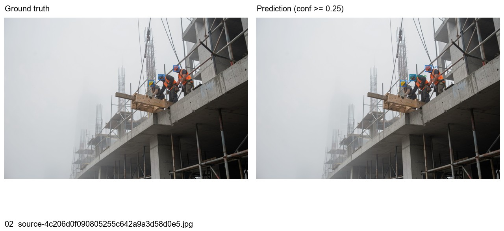
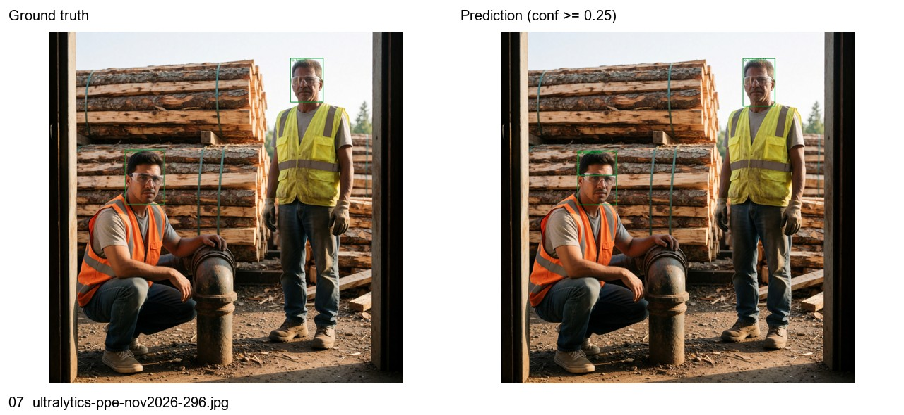
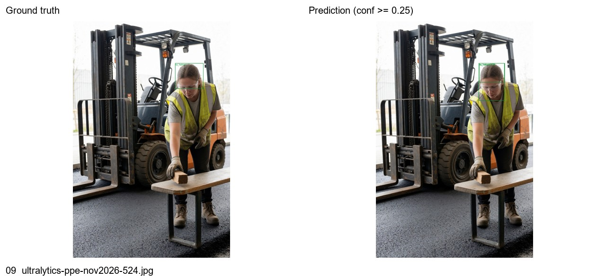
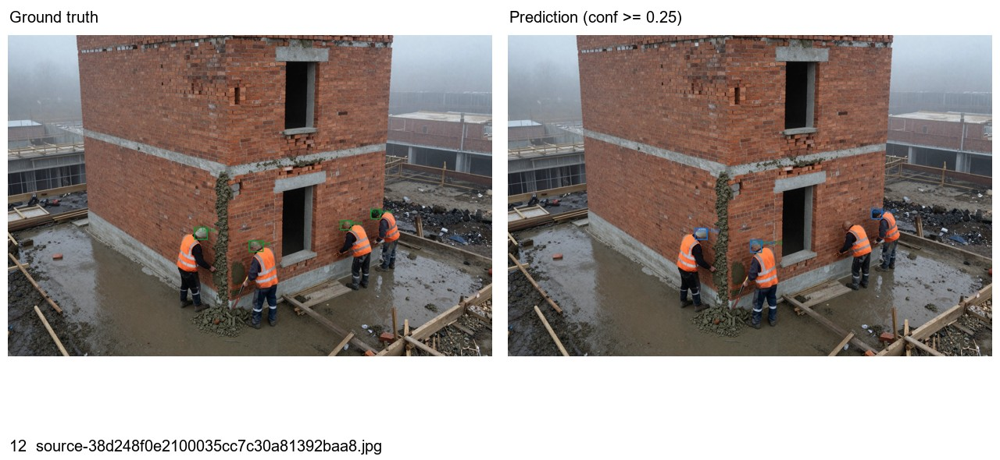
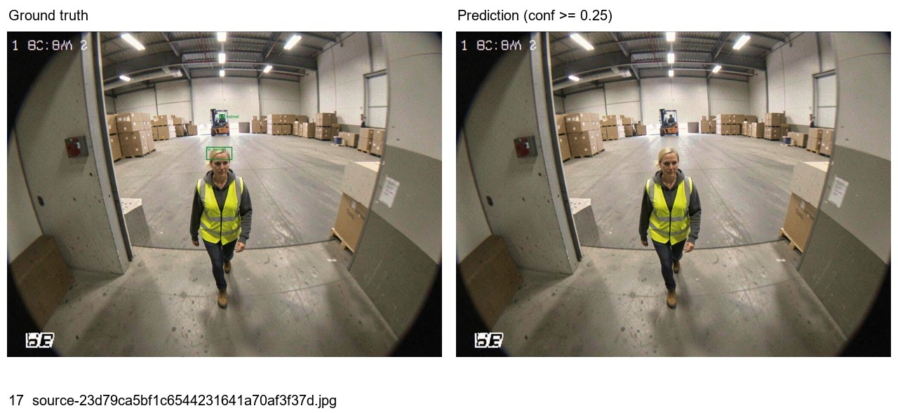
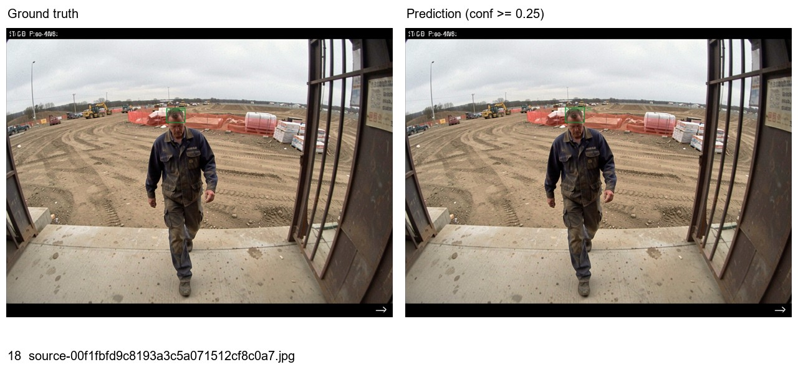
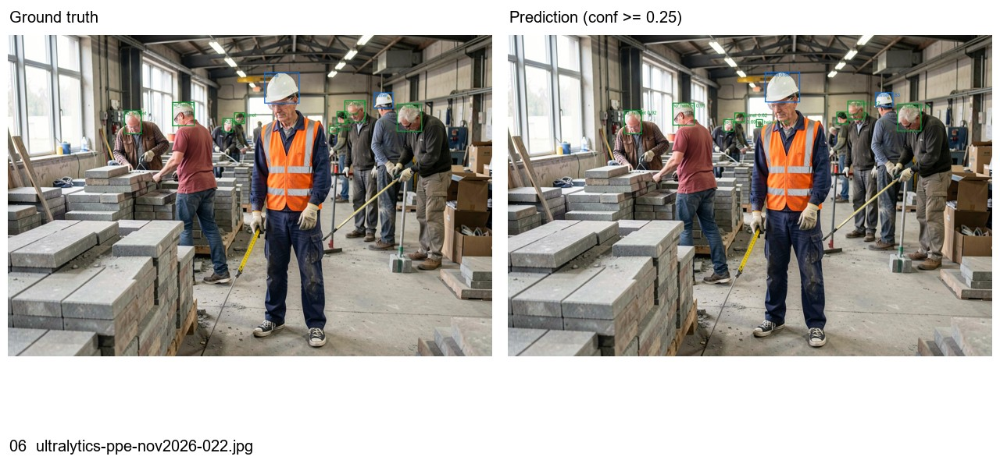

# 2026-11-24 주간 점검

## 진행 내용

기존 best.pt로 검증 이미지 200장을 다시 예측했다. 데이터 1,000장의 이미지·라벨 파일과 기본 형식을 확인했고, 검증 이미지 중 20장을 살펴 대표 사례 8개를 골랐다. 새 모델 학습이나 해상도 비교는 하지 않았다.

- 이미지: 학습 800장, 검증 200장. 대응 라벨 파일 수 일치
- 기본 라벨 형식 오류와 같은 파일 내용의 학습·검증 중복은 발견하지 못함
- 고정 기준: 신뢰도 0.25, 매칭 IoU 0.5, 같은 클래스끼리 1:1 연결
- 미착용: TP 104, FP 13, FN 75 / Precision 0.889, Recall 0.581
- 기본 val: helmet AP50 0.842, no_helmet AP50 0.649

기본 val의 P·R과 신뢰도 0.25 고정 집계는 기준이 다르므로 표를 구분했다. 재실행 환경은 Windows CPU, Python 3.12, torch 2.15.0, Ultralytics 8.4.215다. 원본의 Colab T4와 장비가 달라 속도는 비교하지 않았다.

## 수정한 부분

1. 미착용 정답뿐 아니라 다른 클래스 정답과의 겹침도 기록했다.
2. 중복 예측을 FP로 유지했다. IoU는 원래 값으로 판정하고 출력할 때만 반올림한다.
3. `FN_못봄`을 유효한 정답 연결 없음으로 표현했다. 위치가 어긋난 예측도 들어갈 수 있다.
4. Drive 고정 경로와 이전 결과 폴더 혼선을 피하도록 실행 경로를 정리했다. cv2를 불러오지 않고 사용하던 부분은 PIL로 대체했다.
5. 원본 혼동행렬은 가로 True, 세로 Predicted다. 축 설명을 바로잡았다.
6. 크기·출처의 인과 효과나 라벨 오류를 단정하던 설명을 관찰과 의심 사례로 구분했다. 상대 박스 크기를 바로 8 px로 환산한 설명도 수정했다.

평가 함수의 중복, 클래스 혼동, 빈 입력, 신뢰도·IoU 경계값 등 8개 테스트를 확인했다. 가중치와 데이터 라벨은 바꾸지 않았다.

## 결과 파일

- [클래스별 이미지·박스 수](../../results/week_2026-11-24/class_counts.csv)
- [고정 기준 평가](../../results/week_2026-11-24/fixed_threshold_metrics.csv)
- [기본 val 평가](../../results/week_2026-11-24/official_val_metrics.csv)
- [오탐 13건의 수치와 자동 분류](../../results/week_2026-11-24/fp_review.csv)
- [20장 검토 목록](../../results/week_2026-11-24/reviewed_20_images.csv)
- [대표 사례 기록](../../results/week_2026-11-24/case_notes.csv)

## 대표 사례

초록은 미착용, 파랑은 안전모다. 각 그림의 왼쪽은 정답, 오른쪽은 신뢰도 0.25 이상 예측이다. 오류를 중심으로 골랐으므로 전체 오류 비율을 대표하지 않는다.

### 1. 라벨 범위 의심

미착용 라벨 일부가 머리보다 넓게 사람 몸을 감싼다. 라벨 범위 재검토가 필요하다.



### 2. 다른 클래스와 겹침

일반 모자처럼 보이는 영역에 helmet 정답이 있다. 미착용 예측과 정답 클래스가 다르다. 외형만으로 라벨 오류를 확정하지 않는다.



### 3. 박스 범위 차이

앞쪽 작업자의 머리는 찾았지만 얼굴까지 포함한 정답 박스와 범위가 다르다.



### 4. 중복 예측

같은 미착용 정답 주변에 예측이 두 개 있다. 하나만 TP로 연결하고 나머지는 FP로 유지한다.



### 5. 미착용과 안전모 혼동

미착용 정답이 있는 머리 일부에 helmet 예측이 겹친다. 모자 등 외형의 영향을 의심할 수 있으나 원인을 확정하지 않는다.



### 6. 미착용 미탐

앞쪽 작업자의 미착용 머리를 찾지 못한다. 원거리 사례 외에도 미탐이 있다.



### 7. 미착용 탐지 성공

출입구 앞 작업자의 미착용 머리를 정답과 맞게 찾는다.



### 8. 판독 보류

배경의 작은 영역에 미착용 예측이 있지만 겹치는 머리 정답이 없다. 사람 머리인지 확실하지 않아 보류한다.



## 실행 방법

Colab에서는 [수정 노트북](../../notebooks/ppe_review.ipynb)을 열고 셀을 순서대로 실행한다. 업로드 창에서 전달받은 best.pt 한 개를 올린다. 기존 조원의 Drive 경로는 필요 없다.

PC에서는 필요한 패키지를 설치한 뒤 데이터 폴더와 가중치 경로를 지정한다.

```bash
python -m pip install ultralytics==8.4.215 pyyaml
python scripts/run_review.py --data "데이터폴더/construction-ppe" --weights "가중치폴더/best.pt"
python -m unittest discover -s scripts -p test_ppe_eval.py
```

결과 기본 위치는 `results/week_2026-11-24`다. 다른 위치에 저장하려면 `--out`을 지정한다. best.pt는 조원이 공유한 파일을 사용하며 이번 변경에는 올리지 않았다.

## 남은 점

검증셋은 best.pt 선택에도 쓰여 독립적인 시험 결과로 해석하기 어렵다. 비슷한 장면의 중복까지 전부 확인하지는 않았다. 라벨 의심 사례는 원본을 유지했고, 조원들과 기준을 정해 재검토할 필요가 있다. 조원별 직접 실행 확인과 라벨 검토를 다음 단계로 남겼다.
